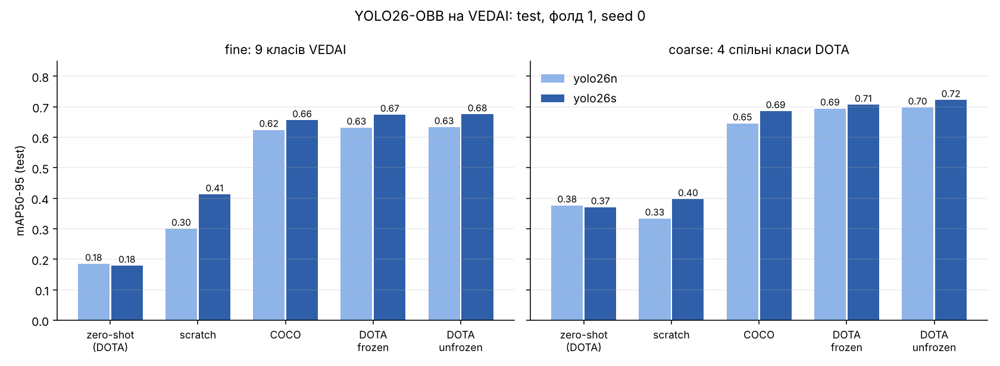

# OBB-aerial

**Дотренування YOLO26-OBB для виявлення техніки на аерознімках (VEDAI) та порівняння способів ініціалізації ваг.**

[](https://colab.research.google.com/github/U-Karpcova/OBB-aerial/blob/main/src/notebooks/YOLO_OBB_VEDAI.ipynb)


На аерознімках техніка розвернута в довільний бік, тому звичайні прямокутні рамки захоплюють багато фону, а сусідні об'єкти перекриваються. Орієнтовані рамки (**OBB**, oriented bounding boxes) лягають на об'єкт щільніше й додатково дають кут повороту.

У цьому проєкті YOLO26-OBB (попередньо навчена на DOTAv1) дотреновується на невеликому датасеті **VEDAI** (9 класів транспортних засобів). Головне питання: **яка ініціалізація ваг дає найкращий результат на малих даних** і наскільки взагалі потрібне дотренування порівняно з zero-shot запуском DOTA-моделі.



## Зміст

- [Головні результати](#головні-результати)
- [Датасет VEDAI](#датасет-vedai)
- [Експерименти](#експерименти)
- [Протоколи оцінки](#протоколи-оцінки)
- [Структура репозиторію](#структура-репозиторію)
- [Швидкий старт](#швидкий-старт)
- [Демо-застосунок](#демо-застосунок)
- [Обмеження](#обмеження)
- [Подальші плани](#подальші-плани)
- [Використані джерела](#використані-джерела)

## Головні результати

Усі числа нижче - це **test-спліт** (124 знімки, 353 об'єкти; у coarse-протоколі 333, бо `other` відкидається), фолд 1, seed 0. `best.pt` обирався за `val`, тому для висновків використовується саме `test`.

### Протокол `fine`: 9 класів VEDAI

| Ініціалізація | n: mAP50 | n: mAP50-95 | s: mAP50 | s: mAP50-95 |
|---|:---:|:---:|:---:|:---:|
| zero-shot (DOTA, без тренування) | 0.221 | 0.185 | 0.212 | 0.179 |
| scratch (з нуля) | 0.440 | 0.300 | 0.595 | 0.413 |
| COCO (backbone з COCO, нова OBB-голова) | **0.816** | 0.624 | **0.852** | 0.656 |
| DOTA, backbone заморожений | 0.783 | 0.631 | 0.827 | 0.674 |
| DOTA, дотренування з розмороженням | 0.789 | **0.633** | 0.841 | **0.675** |

> Для zero-shot у цьому протоколі класи DOTA зводяться до одного представника (`small vehicle` → `car`, `large vehicle` → `truck`, `ship` → `boat`, `plane` → `plane`), решта 5 класів VEDAI отримують AP = 0. Тож це нижня межа: що є зовсім без дотренування.

### Протокол `coarse`: 4 спільні класи DOTA

Тут і GT VEDAI, і передбачення всіх моделей зведені до спільних класів `small vehicle`, `large vehicle`, `ship`, `plane`. Це чесне порівняння дотренованих моделей із zero-shot.

| Ініціалізація | n: mAP50-95 | Δ vs zero-shot | s: mAP50-95 | Δ vs zero-shot |
|---|:---:|:---:|:---:|:---:|
| zero-shot (DOTA) | 0.376 | n/a | 0.370 | n/a |
| scratch | 0.333 | −0.043 | 0.397 | +0.027 |
| COCO | 0.645 | +0.269 | 0.686 | +0.316 |
| DOTA, frozen | 0.694 | +0.318 | 0.706 | +0.336 |
| DOTA, unfrozen | **0.697** | **+0.321** | **0.722** | **+0.352** |

### Висновки

1. **Претрейн критично важливий.** З нуля на ~950 тренувальних знімках модель вчиться слабо (0.30 / 0.41 mAP50-95) і в coarse-протоколі для `n` навіть гірша за zero-shot DOTA.
2. **Дотренування сильно покращує zero-shot.** У coarse-протоколі приріст становить +0.32 (`n`) і +0.35 (`s`) mAP50-95.
3. **COCO, DOTA frozen і DOTA unfrozen близькі між собою.** За mAP50-95 DOTA-ваги трохи попереду COCO (+0.7…+1.9 п.п. у fine, +2…+5 п.п. у coarse), але за mAP50 у fine COCO навіть трохи вище. Розморожування backbone майже нічого не додає (≤ 0.2 п.п. mAP50-95 у fine). На одному seed такі різниці лежать у межах шуму, тому переконливо стверджувати можна лише «претрейн ≫ scratch».
4. **Більша модель допомагає:** у fine-протоколі `s` краще за `n` приблизно на 3–4 п.п. mAP50-95 для всіх варіантів із претрейном.

### AP50-95 по класах (yolo26s, test, fine)

| Клас | zero-shot | scratch | COCO | DOTA frozen | DOTA unfrozen |
|---|:---:|:---:|:---:|:---:|:---:|
| car | 0.379 | 0.548 | 0.717 | 0.698 | 0.725 |
| truck | 0.106 | 0.300 | 0.631 | 0.556 | 0.589 |
| tractor | 0.000 | 0.402 | 0.657 | 0.612 | 0.662 |
| camping_car | 0.000 | 0.550 | 0.704 | 0.710 | 0.722 |
| van | 0.000 | 0.416 | 0.674 | 0.831 | 0.636 |
| other | 0.000 | 0.310 | 0.448 | 0.502 | 0.485 |
| pickup | 0.000 | 0.497 | 0.705 | 0.622 | 0.692 |
| boat | 0.221 | 0.226 | 0.562 | 0.631 | 0.682 |
| plane | 0.904 | 0.464 | 0.804 | 0.904 | 0.883 |

- Найлегший клас `plane`, але в VEDAI їх лише 47, тож цифра нестабільна. Те саме стосується `van` (101 об'єкт).
- Найважчі класи: `other` (збірна категорія) і `truck`.
- На матриці помилок найкращої `s`-моделі ([confusion_matrix_normalized.png](runs/vedai/yolo26s/dota_unfrozen/fold01_seed0/eval_test/confusion_matrix_normalized.png)) частина `car` (≈ 23 %) і `truck` (≈ 16 %) помилково визначається як `pickup`, а `van` плутається з `truck` (≈ 33 %) і `car` (≈ 22 %).

Криві навчання: [results.png](runs/vedai/yolo26s/dota_unfrozen/fold01_seed0/stage2/results.png) (етап 2 моделі `s`). Усі прогони можна переглянути в TensorBoard (див. [Швидкий старт](#швидкий-старт)).

## Датасет VEDAI

[VEDAI](https://downloads.greyc.fr/vedai/) (Vehicle Detection in Aerial Imagery) це набір аерознімків із дрібною технікою. Використана RGB-версія **1024×1024**.

**Формат оригінальної анотації** (14 чисел у рядку):
`x_center y_center angle(рад) class_id is_contained is_occluded x1 x2 x3 x4 y1 y2 y3 y4`.
Конвертер переводить чотири кути полігона у формат YOLO-OBB (нормовані координати) і зберігає метадані про кожен об'єкт (occluded, contained, розміри) в `meta/objects.csv`.

**Що знайшлося в сирих даних і як це оброблено:**

| Знахідка                                                      |     Кількість     | Рішення                                                   |
|---------------------------------------------------------------|:-----------------:|-----------------------------------------------------------|
| Знімки без файлу анотацій                                     |        18         | відкинуто (не можна вважати "фоном", на них була техніка) |
| Файли з рядками не у форматі з 14 чисел (по 5 чисел)          | 4 файли, 31 рядок | знімки відкинуто                                          |
| Знімки з класами `motorcycle` (4 об'єкти) і `bus` (3 об'єкти) |         7         | класи виключено як надто рідкісні, знімки відкинуто       |
| Об'єкти з центром поза знімком / обрізані по межі             |      11 / 46      | перші відкинуто, другі обрізано по межі                   |

Підсумок: із 1268 знімків лишається **1239** і **3 718 об'єктів** у 9 класах.

| Клас     | car  | pickup | camping_car | truck | other | tractor | boat | van | plane |
|----------|:----:|:------:|:-----------:|:-----:|:-----:|:-------:|:----:|:---:|:-----:|
| Об'єктів | 1354 |  950   |     397     |  306  |  202  |   190   | 171  | 101 |  47   |

**Розбиття.** 10 фолдів зі стратифікацією за найрідкіснішим класом знімка. Для кожного фолду: окремий `test`-фолд, а решта ділиться на `train` і `val` у пропорції 85 / 15. Зараз повністю пораховано **фолд 1**: 947 train / 168 val / 124 test знімків.

## Експерименти

Архітектура зафіксована (YOLO26-OBB), розміри **n** та **s**. Порівняно чотири способи ініціалізації й zero-shot baseline:

| `init`          | Старт                                                    | Режим тренування                                                                                                 |
|-----------------|----------------------------------------------------------|------------------------------------------------------------------------------------------------------------------|
| `zeroshot`      | `yolo26{n,s}-obb.pt` (DOTA)                              | без тренування, лише оцінка                                                                                      |
| `scratch`       | `yolo26{n,s}-obb.yaml`                                   | один етап, з випадкових ваг                                                                                      |
| `coco`          | той самий yaml + ваги `yolo26{n,s}.pt` (OBB-голова нова) | один етап                                                                                                        |
| `dota_frozen`   | `yolo26{n,s}-obb.pt`                                     | один етап, backbone заморожений (`freeze=11`)                                                                    |
| `dota_unfrozen` | `yolo26{n,s}-obb.pt`                                     | етап 1 (20 епох): backbone заморожений; етап 2 (30 епох): все розморожено, менший lr, старт із `best.pt` етапу 1 |

**Гіперпараметри** (однакові для всіх прогонів):

| Параметр       | Значення                                                    |
|----------------|-------------------------------------------------------------|
| Розмір входу   | 1024                                                        |
| Batch          | 8                                                           |
| Оптимізатор    | AdamW, `lr0 = 0.001` (етап 2 у `dota_unfrozen`: `0.0005`)   |
| Кількість епох | 50 (для `dota_unfrozen`: 20 + 30)                           |
| Аугментації    | типові для Ultralytics + `flipud = 0.5`, `close_mosaic = 5` |
| Заморожування  | `freeze = 11` (backbone YOLO26 це шари 0..10)               |
| Seed / фолд    | 0 / 1                                                       |

Прогін всіх конфігурацій для одного розміру моделі займає близько 4-5 годин на Tesla T4 у Colab.

## Протоколи оцінки

Кожен прогін оцінюється на `val` і `test` у двох протоколах, результати лежать у `summary.json`:

| Протокол                  | Класи                                             | Призначення                                                                            |
|---------------------------|---------------------------------------------------|----------------------------------------------------------------------------------------|
| `fine` (`final`)          | 9 класів VEDAI                                    | основна метрика дотренованих моделей                                                   |
| `coarse` (`final_coarse`) | `small vehicle`, `large vehicle`, `ship`, `plane` | чесне порівняння з zero-shot: GT і передбачення всіх моделей зводяться до одних класів |

Відповідність класів VEDAI → DOTA для coarse-протоколу:

| DOTA            | Класи VEDAI                            |
|-----------------|----------------------------------------|
| `small vehicle` | car, pickup, van, camping_car, tractor |
| `large vehicle` | truck                                  |
| `ship`          | boat                                   |
| `plane`         | plane                                  |
| (відкидається)  | other                                  |

Спірні рядки (`camping_car`, `tractor`, `other`) перевіряються функцією `zeroshot_class_affinity()`: вона показує, у які класи DOTA zero-shot модель насправді відносить об'єкти VEDAI. Наприклад, `tractor` і `camping_car` zero-shot моделлю майже не знаходяться (≈ 97–99 % пропущено, модель `s`, train-спліт).

## Структура репозиторію

```
OBB-aerial/
├── src/notebooks/
│   └── YOLO_OBB_VEDAI.ipynb   # весь пайплайн: дані -> прогони -> TensorBoard -> зведення
├── app.py                     # демо на Streamlit
├── scripts/
│   └── prepare_vedai.py       # функції підготовки VEDAI (inspect / convert / viz)
├── configs/data/vedai.yaml    # DATA_CFG: класи, спосіб оброблення для поганих даних, параметри фолдів
├── runs/
│   ├── _results/              # зведені таблиці
│   └── vedai/<модель>/<init>/fold01_seed0/
│       ├── config.yaml        # конфіг прогону
│       ├── env.json           # версії python / ultralytics / torch
│       ├── summary.json       # метрики fine + coarse, val + test
│       ├── tb/                # логи TensorBoard
│       ├── <етап>/            # weights/best.pt, results.csv, графіки навчання
│       └── eval_*/            # матриці помилок, PR-криві, приклади передбачень
├── test_images/               # знімки для швидкої перевірки демо
├── plots/                    # картинки для README
└── yolo26{n,s,m}-obb.pt       # офіційні DOTA-ваги (для zero-shot)
```

Назви етапів: `full` (scratch, coco), `frozen` (dota_frozen), `stage1` і `stage2` (dota_unfrozen). Остання комірка синхронізує `runs/` із Colab у цей репозиторій.

**Тестові знімки** (`test_images/`): `vedai_test_data`, зразки з інших OBB-датасетів (`mar20_test_data`, `dior_r_test_data`) і реальні аерознімки без розмітки (`real_test_data`). Останні призначені лише для якісного огляду поведінки моделі поза VEDAI.

## Швидкий старт

### Перегляд результатів і демо локально

```bash
git clone https://github.com/U-Karpcova/OBB-aerial.git
cd OBB-aerial
pip install -r requirements.txt
```

> Репозиторій важить близько 0.6 ГБ через ваги й логи. Для запуску на CPU зручно спершу поставити легкий PyTorch:
> `pip install torch torchvision --index-url https://download.pytorch.org/whl/cpu`

```bash
streamlit run app_old.py          # демо
tensorboard --logdir runs     # криві навчання та метрики всіх прогонів
```

### Відтворення експериментів у Colab

1. Відкрити `YOLO_OBB_VEDAI.ipynb` у Colab (кнопка зверху), працює на GPU (T4).
2. Підключити Google Drive: прогони та логи пишуться в `MyDrive/obb-aerial/runs`, тож вони переживають перезапуск середовища.
3. Запускати секції по черзі: середовище -> конфіг -> завантаження VEDAI -> `inspect_raw()` -> `convert_dataset()` -> `viz_labels()` -> протоколи оцінки та раннер.
4. Перевірити пайплайн smoke-тестом (1 + 1 епоха на `imgsz=320`), потім запустити:

```python
GRID = dict(inits=list(INITS), sizes=["s"], seeds=[0], folds=[1])

run_grid(inits=[ZERO_SHOT], sizes=GRID["sizes"], folds=GRID["folds"])   # zero-shot baseline
run_grid(**GRID)                                                       # усі чотири ініціалізації
results = report(split="test")                                         # таблиці й графіки в RUNS_DIR/_results
```

Завершені прогони та етапи пропускаються, а перервані етапи відновлюються з `last.pt`. Тож код можна безпечно запускати повторно й розширювати новими розмірами чи seed.

**Середовище:** Python 3.13, Ultralytics 8.4.212, PyTorch 2.14.1 (CUDA), Tesla T4.

## Демо-застосунок

`app.py` це Streamlit-застосунок для розпізнавання техніки на власних знімках:

- вибір моделі: усі `best.pt` із теки `runs`, офіційні DOTA-ваги (zero-shot) або власний `.pt`;
- поріг впевненості, розмір входу (моделі тренувались на 1024) та пристрій (CPU / GPU);
- знімок з орієнтованими рамками, таблиця детекцій (клас, впевненість, координати, довжина, ширина, кут) і підсумок по класах;
- вивантаження результатів у CSV.

Застосунок працює на CPU, GPU використовується лише за наявності й вибору.

## Обмеження

- **Один seed і один фолд.** Різниці в 1–2 п.п. між COCO, DOTA frozen та DOTA unfrozen не можна вважати значущими. Для надійного порівняння потрібні кілька seed-ів (mean ± std) та інші фолди; раннер і `report()` вже це підтримують.
- **Невеликий датасет і рідкісні класи.** У `plane` лише 47 об'єктів, у `van` 101, тож AP по цих класах сильно коливатиметься.
- **Виключені класи.** `motorcycle` і `bus` (3–4 об'єкти) не входять у навчання, тому модель їх не розпізнає.
- **Мапінг у DOTA умовний.** Відображення VEDAI → DOTA (наприклад, `camping_car` і `tractor` → `small vehicle`) - це вибір, який впливає на coarse-метрики.
- **Знімки VEDAI зняті в схожих умовах**, тож якість на реальних знімках з іншою роздільністю чи ракурсом не гарантована (папка `test_images/real_test_data` для перевірки якості).

## Подальші плани

- повторити прогони на кількох seed і фолдах та рахувати mean ± std;
- додати розмір `m`;
- повторити експеримент на іншому датасеті (наприклад, MAR20);
- докладніше розібрати помилки за класами та типами втрат.

## Використані джерела

- **VEDAI**: S. Razakarivony, F. Jurie, *Vehicle Detection in Aerial Imagery: A small target detection benchmark*, Journal of Visual Communication and Image Representation, 2016.
- **Ultralytics YOLO**: тренування, валідація, офіційні OBB-ваги.
- **DOTA** і **COCO**: датасети, на яких навчені стартові ваги.

